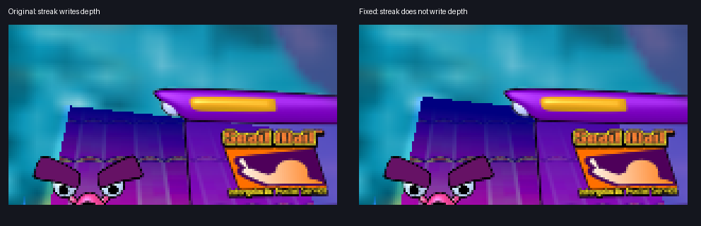

# Original bugs

The [Ultimate profile](README.md#gameplay-profiles) corrects the Windows
gameplay, input and presentation bugs catalogued here. Original preserves
their Windows behavior. Both profiles use the host's monotonic clock, which
already avoids the Windows uptime bug (20).

A fix that acts around a function wraps it (`port/wrapped.txt`) and lives in
`port/shell/fixes.cpp` or `port/shell/extras*.cpp`; one that acts inside it
patches the function's copy at the site (`port/patches/`). The recovered source
in `decomp/` stays as the original compiled it. The first two fixes change only
what is drawn, the tally fix (3) changes lives, and the name fix (4) acts only
when a new high-score name is cancelled; the replay and session oracles play
Original, so they match either way.

## 1) Slugs and garbage appear upright for a frame

Native behaviour:

- `cRSubGame::AddSlug` (`spawn_slug_hazard`, `0x43dc80`) and
  `cRSubGame::AddGarbage` (`spawn_track_garbage_hazard`, `0x43da80`) place the
  hazard on its cell and call `CalcRealPos`, which returns the track's tilt
  there as `attachment_facing_angle`. They then allocate the hazard's sprite
  but leave its `facing_angle` at the 0 that `cRSprite::Init` sets.
- The sprite only turns in the hazard's own update. `cRSlug::AI`
  (`update_slug_hazard_ai`, `0x43f930`) and `cRSubGarbage::AI`
  (`update_garbage_hazard`, `0x43f200`) set
  `facing_angle = heading_roll + attachment_facing_angle`, plus the player's
  `follow_state.orientation_b` while the player rides a path.
- A hazard spawns during `cRSubGame::AI`, after that tick's hazard updates have
  run, so the frame drawn on its spawn tick shows it upright. On the next
  tick it snaps to the track's angle.

Why it's a bug:

- The spawn code already has the angle, and every later frame uses it. Only the
  first frame draws the hazard upright.
- On flat track the angle is 0 and nothing shows. It shows where hazards spawn
  on tilted cells: `Angle=` segments, Wibble, and half-pipes. In Pro-Challenge's
  "Pros Only" (HalfPole, `Wibble.txt Angle=±30`), a slug at z 110.5 has a facing
  of 0 on its spawn tick and 0.196 from the next tick on.
- All four functions are byte-matched, so this is the original's code. Android's
  `cRSubGame::AddSlug` (`0007953c`) doesn't set the facing at spawn either.

Evidence: with `--trace`, the headless build prints `upright_hazards N`
whenever the number of active hazards drawn upright on a tilted cell changes.
Before the fix, replays A1, A3, A4 and A5 each showed such a hazard on three
spawn ticks. After it, none of the 20 replays does.

Port behaviour:

- `AddSlug` and `AddGarbage` run unchanged, then the wrapper gives the new
  sprite the facing its first update would give it.
- The facing is presentation only. Nothing in play reads it, and both oracles
  match (20/20 replays, 10/10 sessions).

## 2) Background streaks cut holes in the road

The starfield renders before the world, using `Sprites/StarTail.tga` in
`RENDER_SCENE_OVERLAY_1`. Its sprites sit 50 units from their camera, while
`render_camera` uses a far plane of 52. The recovered sprite draw inherits
enabled depth writes, so a streak can prevent the last two units of road
from rendering. The moving background then shows through the road horizon.

This was reproduced in the browser on Pro 1 (Pros Only), including its paused
view. A captured frame replay with streaks shifted across the horizon lost
31 road pixels at 640 by 480; suppressing only their depth writes restored
them. The foreground mailbox is nearer and is unaffected by this fix.

The comparison replays the same captured scene and moves the captured streaks
across the horizon to hold the overlap fixed. Only their depth writes differ.

`port/shell/fixes.cpp` wraps `draw_sprite_quad` and suppresses depth
writes only for StarTail sprites in the background scene. It restores the
previous setting after each draw. The streaks still blend over the backdrop;
world geometry and foreground particles retain their depth writes. The fix
runs in the shared shell, so browser and native presenters receive the same
corrected state. Recovered source in `decomp/` is unchanged.

The matched Windows functions already contain the cause:
`initialize_star_field` (0x434310) puts the stars at distance 50;
`render_camera` (0x411fa0) enables depth writes with a far plane of 52;
`draw_sprite_quad` (0x4137f0) does not disable them. Their retained matching
receipts show 247/247, 180/180 and 259/259 instructions respectively. This
identifies a bug inherited from the shipped renderer; the visual reproduction
above was performed in the port, rather than the original Windows executable.

The runtime regression test drives the real browser WASM in both profiles and
checks all 36 background draws: they write depth in Original and not in
Ultimate, and the world draws following them still write depth.

## 3) Skipping the delivery tally loses the bonus's extra life

Native behaviour:

- Every 50,000 points award an extra life, up to 9, and only
  `cRSubGoldy::ScoreAdd` (`add_subgoldy_score`, `0x4402c0`) checks for it.
- A watched tally pays each parcel, and the level bonus once the last one
  lands, through `ScoreAdd` (`cRCompletion::RegisterParcel`,
  `register_parcel_delivery`, `0x405040`). A perfect postal delivery's bonus
  is 50,000, so it always awards a life.
- From two seconds into the hand-off until the summary, a click skips the rest
  of the tally (`cRSubGoldy::AI`), and `cRCompletion::UnInit`
  (`flush_row_event_display`, `0x404830`) settles it. It pays the remaining
  parcels through `ScoreAdd`, but the bonus as `ScoreAdd(bonus_score, 0)`
  (the call at `0x404887`): the bonus becomes the score kind, which `ScoreAdd`
  reports as "Unknown Score Type" and scores 0. It then sets `total_score` to
  the tally's total directly.

Why it's a bug:

- The total comes out right, but the bonus never meets the extra-life check,
  so skipping the tally of a perfect delivery costs a life. A postal course
  without parcels pays its whole bonus that way, watched or not;
  `cRCompletion::AI` pays it at the summary only in Challenge.
- Every other call passes a score kind first; the bonus belongs second, as
  `RegisterParcel` passes it.
- Android's and iOS's `cRCompletion::UnInit` (`00061740`, `00062c34`) pay the
  bonus as `ScoreAdd(5, bonus)` and any remaining difference from the tally's
  total as `ScoreAdd(5, difference)`.

Port behaviour:

- `port/patches/09-completion-rules.patch` makes Android's two changes in
  Ultimate; Original keeps the call and the assignment.
- The runtime regression test (`tests/test_port_mobile_rules.py`) drives a
  probe course without parcels in both profiles, once watching the tally and
  once skipping it with three parcels owed. Both profiles end on the same
  score; only Ultimate gains the life.

## 4) Cancelling a new name fills the table with Challenge scores

Native behaviour:

- A run that makes the Postal table (`cRSubHighScore::AddArcade`, `0x4176a0`)
  or the Challenge table (`AddSurvival`, `0x417780`) is inserted at its rank,
  and the rows below it shift down into the table's spare eleventh row. The
  High Scores screen then asks for a name.
- Its Cancel button (`cRHighScore::AI`, `update_high_score_screen`, `0x417260`)
  calls `cRSubHighScore::MiniDelete` (`mini_delete_high_score_entry`,
  `0x417af0`) to close the gap again: for each row from the cancelled rank to
  the ninth, `active_record_bank[row] = survival_records[row + 1]`. The source
  is a fixed offset from the table owner (`lea ebx, [eax + edx + 0x17c108]`,
  `survival_records[1]`), whichever table is on screen.

Why it's a bug:

- Cancelling a Challenge name shifts the Challenge table back as intended,
  only because source and destination are the same table there.
- Cancelling a Postal name overwrites the cancelled row and every row below
  it with the Challenge rows one rank further down, names, scores and replays
  included, and the next save writes them to `ScoreA.dat`. The port enters a
  Pro name on the Postal bank with the Pro table swapped in, so without the fix
  they would reach Pro's score file (`ScorePro-v5.dat`).
- Android's `cRSubHighScore::RemoveHighScore` (`00065270`), which its Cancel
  calls with the entry's bank and rank, deletes the cancelled entry and shifts
  the rows below it up within that bank (Postal, Challenge or Pro); iOS's
  `cRHighScore::AI` (`0003f000`) does the same inline.

Port behaviour:

- `MiniDelete` shifts the rows below the cancelled one up within the table on
  screen, which restores that table as it was before the insert.
- `tests/test_port_frontend_rules.py` cancels a Postal name in each profile
  and a Pro name in Ultimate: Original fills the Postal rows with Challenge
  scores, Ultimate restores both tables.

## Other verified Windows bugs

The addresses below refer to `SnailMail_unwrapped.exe`. The x86 probes ran
instructions from that executable with controlled inputs. Course and replay
checks used the Original profile with the Windows archive. Where a control
changed an asset or a starting position, the entry identifies the change.

| Entries | Ultimate behavior | Regression in `tests/` |
|---|---|---|
| 5, 6 | Challenge places digit parcels relative to the new road. Postal fills shortages from unused authored rows without another random draw, and scales the quota if the course cannot fit the requested count. | `test_port_parcel_placement.py` |
| 7, 8, 10, 11 | The level loader reads a filename after the list header and accepts `Slug:` as an alias. The segment importer recognizes `Ring=Explosive` and `No Fall`. | `test_port_course_tags.py` |
| 9, 14 | Both bracket ramp glyphs reflect and produce opposite rolls. The heart's pickup volume reaches from its base to its bobbing sprite. | `test_port_ramps_and_hearts.py` |
| 12, 13 | Lasers test asteroid collisions along the distance traveled each tick. Rockets resolve normal damage and splash before retiring at their target. | `test_port_projectile_contacts.py` |
| 15, 18 | Each salt draw uses its own distance-scaled tint, including on the spawn frame. Double quotes use the quote glyph. | `test_port_salt_and_font.py` |
| 16, 17 | The finish clock credits the fraction of the tick spent reaching the line. A line break consumes one character of the high-score name limit. | `test_port_frontend_rules.py` |
| 19, 20 | Ultimate delivers mouse transitions across input polls. Both host clocks keep their precision past eight days and across the 32-bit millisecond boundary. | `test_port_input_clock.py` |

### 5) A previous course can bury a Challenge parcel

Start “Tramponus Durus” (Postal XLVII, build seed 9507), end the run, then
start Challenge with speed and difficulty both at 50 and build seed 20219.
At row 1291, lane 1, the parcel is at `y = -2` under a road at `y = 0`.
A fresh process with the same Challenge seed puts it at `y = 1`.

When building a `0` parcel marker, the track builder (`0x435eb0`) copies
the old cell height before setting the new road height. The Postal course
left a trampoline at `y = -3` in that cell. Challenge placement
(`0x444240`) then adds one to the copied height. The Windows collision
routine collected the fresh parcel on a centered approach and missed the
buried one on the same approach.

### 6) Loopsville sometimes starts one parcel short

Postal XIII specifies 40 parcels. Its HUD opens at `0/39` with build seed
32523 and at `0/40` with seed 9507. `PlaceParcels` (`0x4438e0`) picks
groups, fills the remainder from individual candidates, then replaces the
authored total with however many it placed. Some group choices exhaust the
individual candidates early. The x86 routine also changed the internal quota
from 20 to 78 when it placed 39. The player sees a 39-parcel total.
Ultimate's mobile-generator seed 17673 also produced 39 parcels with quota
78 before the fix. It now produces all 40 with the authored quota of 20.

### 7) Four Postal routes lose their opening Wibble

In `ARCADE006.TXT` through `ARCADE009.TXT`, the first `Wibble.txt` is on
the same line as `Segments Begin:`, immediately after the closing comment.
`cRSubTracks::Init` (`0x447480`) advances to the next line before reading
the first filename, dropping all 43 rows. On Postal VI, “Keep Still!”,
ParcelTest follows the standard Start segment and the finish is at row 712.
Moving just `Wibble.txt` onto its own line makes it the first of 13 listed
segments and moves the finish to row 755. Android ships that newline on Postal VI.

### 8) Loopy's random garbage never spawns

Postal III declares `Slug:10` where Postal I and II use `Garbage:10`.
The Windows loader (`0x447480`) searches for `Garbage:` and uses −1 when
it is absent. The resulting ambient spawn test requires a random number
below one to exceed 1.002. Changing the field name alone restores the
authored value of 10. Explicitly placed hazards use a separate spawn path.

### 9) A mirrored Jump Pod ramp still rolls the same way

On Postal II, row 341, the `[` ramp moves from lane 3 (seed 14895) to
lane 4 (mirrored, seed 292). Both versions produce tile 5 and a roll
amplitude of +1. `LevelConvert` (`0x437270`) returns `[` again when
mirroring `[`. The player update (`0x43b120`) consequently selects the
same roll direction on both sides of the road.

### 10) The tutorial skips its authored explosive ring

`TUTORIAL 11.TXT` requests `Ring=Explosive` at row 793 of the tutorial.
The segment importer (`0x448160`) looks for `Ring=Explode`. The stock
row creates no ring. Correcting just that spelling adds an explosive ring
at `z = 793.5`. The preceding ramp independently produces another ring
at `z = 805.5` in both runs, so a player can still complete the lesson.

### 11) SuperTramp2 applies extra drag on 48 marked rows

Postal XLVII and XLVIII both use `SUPERTRAMP2.TXT`. It spells the tag
`No Fall` on 48 rows. The importer (`0x448160`) recognizes `NoFall`,
so all 48 lack runtime flag `0x100`. Correcting the spelling in a copy
sets the flag on all 48. On Postal XLVII row 1680, a snail leaving a path
with forward speed 0.35 slowed to 0.291 in one tick. Setting just the flag
gave 0.349 under the same conditions. The flag suppresses the extra
post-path drag in `cRSubGoldy::AI` (`0x43b120`).

### 12) A laser can pass straight through an asteroid

`cRSubGolb::AI` (`0x414820`) moves a shot, then checks for garbage
at its new position. In the Windows routine a laser sampled at `z = 16, 19,
22` passed through a radius-0.64 asteroid centered at 20.5 without scoring.
Moving just the asteroid to 19.5 made the shot burst it for 10 points at
the `z = 19` sample. The test skips the space between those samples.

### 13) A point-blank homing rocket can explode without hitting its target

The rocket updater (`0x414820`) checks its distance to the stored target
position before it checks for damage. Inside 0.4 units it plays the
explosion effect and retires the rocket. In the Windows launch and impact
routines, a rocket fired straight at an asteroid from 1.1 units away
exploded, left the asteroid active and awarded zero. From 1.3 units away
the same rocket hit for 10 points. Android's updater (`0x635d4`) has the
same early return.

### 14) A jumping snail can pass through the visible heart

The heart sprite bobs up to 0.6 units above its base (`0x43ecc0`).
Collection checks for a vertical separation below 0.4 from the fixed base
(`0x444cf0`). On Loopsville's Danger Ramps, a controlled approach passed
within 0.27 units of the drawn heart at `z = 384.5`, but the heart stayed
active. In the x86 collision routine, placing the snail at the raised
sprite center missed. Placing it at the base collected it.

### 15) Salt calculates a distance fade that the renderer never uses

`cRSalt::AI` (`0x441c10`) stored fade values of 0, 0.5 and 1 at
distances of 46, 23 and 0 units in the Windows probe. At every distance
the next instruction sequence set the body's alpha to 0.9. The shared salt
mesh also lacks the per-draw tint flag. Original submitted vertex alpha 255
at every distance tested. Ultimate submitted 0 and 229 for a distant and a
nearby crystal sharing the mesh in the same frame. Camera fog is separate.

### 16) Time Trial undercounts the finish tick

The finish code (`0x43c70c`) converts the fraction of the tick spent
reaching the line into seconds. It passes those seconds to `cRTime::Add`
(`0x441b90`), which expects ticks and divides by 60 again. For a halfway
crossing the x86 clock advanced 0.139 ms where it should advance 8.333 ms.

The Windows recording in `tests/fixtures/replays/ScoreC.windows-2026-04-17.dat`
makes the effect visible. “Watch Best Trial” on route VI, “Keep Still!”,
reaches the finish 12.028 ms into the tick and credits 0.200 ms. The saved
and replayed time reads `0:30:76`. Using the crossing fraction once gives
`0:30:77`. Android's finish code (`0x7d7ac`) also converts twice.

### 17) Ctrl+Enter bypasses the high-score name limit

Enter 16 letters in a new high-score name. The Windows editor refuses
another letter but accepts Left Ctrl+Enter as a line break. Enter then submits
a 17-character name. `cRBorder::InputText` (`0x4035b0`) checks the length
for ordinary characters and skips that check when inserting the game's
`>` line-break marker. The original keyboard reader and editor reproduced
the difference with the same full name.

### 18) The “Under Construction” route card drops its quotation marks

Postal XXV's route description puts double quotes around “Under
Construction”. Windows `FontASCIIRemap` (`0x449d20`) maps a double quote
to slot `0x35`, the blank, although the menu atlas has the quote at
`0x40`. The font draw skips blank slots. Android (`0x31a84`) and iOS
(`0x0e94c`) map the same character to the quote glyph.

### 19) A quick click can leave “Click to Start” waiting

The Windows message handler (`0x4074b0`) sets the button latch on press
and clears it on release. If both messages arrive before one input poll,
the press is lost. Running both messages through the original window
procedure, button reader and game input left the start prompt in state 2
(waiting). Moving only the release until after the poll produced pressed
bit `0x4000` and advanced the same prompt to state 3.

### 20) Windows uptime coarsens the frame clock and can freeze the game

The main loop (`0x406fc7`) stores absolute system uptime in single-precision
seconds before subtracting the previous timestamp. With clock samples one
millisecond apart, its timestamps advanced in 62.5 ms steps at eight days
of uptime, 125 ms at sixteen days, and 500 ms at 49 days.

The underlying 32-bit millisecond clock wraps about every 49.7 days. With
the previous sample at `0xfffffff0` and zero accumulated time, the x86
loop waited at both `0xffffffff` and zero. Even the largest possible new
timestamp only equaled the stored one. In that state the game never
reaches the next message pump. The port uses its hosts' clocks.
