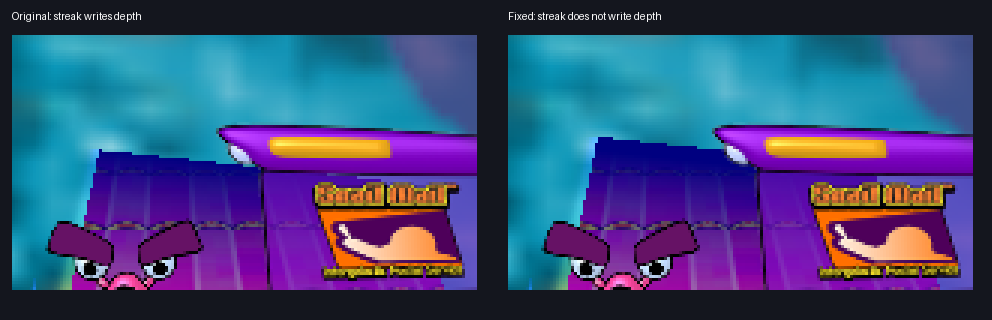

# Original bugs

The shipped `SnailMail.exe` has a few behaviours that read as genuine bugs once
the recovered source shows how they arise. The
[Ultimate profile](README.md#gameplay-profiles) fixes every one listed here;
the Original profile keeps them, as the oracles require.

A fix that acts around a function wraps it (`port/wrapped.txt`) and lives in
`port/shell/fixes.cpp` or `port/shell/extras*.cpp`; one that acts inside it
patches the function's copy at the site (`port/patches/`). The recovered source
in `decomp/` stays as the original compiled it. The first two fixes change only
what is drawn, the tally fix (3) changes lives, and the name fix (4) acts only
when a new high-score name is cancelled; the replay and session oracles play
Original, so they match either way.

## 1) Slugs and garbage appear upright for a frame

Native behaviour:

- `cRSubGame::AddSlug` (`spawn_slug_hazard`, `0x43dc80`) and
  `cRSubGame::AddGarbage` (`spawn_track_garbage_hazard`, `0x43da80`) place the
  hazard on its cell and call `CalcRealPos`, which returns the track's tilt
  there as `attachment_facing_angle`. They then allocate the hazard's sprite
  but leave its `facing_angle` at the 0 that `cRSprite::Init` sets.
- The sprite only turns in the hazard's own update. `cRSlug::AI`
  (`update_slug_hazard_ai`, `0x43f930`) and `cRSubGarbage::AI`
  (`update_garbage_hazard`, `0x43f200`) set
  `facing_angle = heading_roll + attachment_facing_angle`, plus the player's
  `follow_state.orientation_b` while the player rides a path.
- A hazard spawns during `cRSubGame::AI`, after that tick's hazard updates have
  run, so the frame drawn on its spawn tick shows it upright. On the next
  tick it snaps to the track's angle.

Why it's a bug:

- The spawn code already has the angle, and every later frame uses it. Only the
  first frame draws the hazard upright.
- On flat track the angle is 0 and nothing shows. It shows where hazards spawn
  on tilted cells: `Angle=` segments, Wibble, and half-pipes. In Pro-Challenge's
  "Pros Only" (HalfPole, `Wibble.txt Angle=±30`), a slug at z 110.5 has a facing
  of 0 on its spawn tick and 0.196 from the next tick on.
- All four functions are byte-matched, so this is the original's code. Android's
  `cRSubGame::AddSlug` (`0007953c`) doesn't set the facing at spawn either.

Evidence: with `--trace`, the headless build prints `upright_hazards N`
whenever the number of active hazards drawn upright on a tilted cell changes.
Before the fix, replays A1, A3, A4 and A5 each showed such a hazard on three
spawn ticks. After it, none of the 20 replays does.

Port behaviour:

- `AddSlug` and `AddGarbage` run unchanged, then the wrapper gives the new
  sprite the facing its first update would give it.
- The facing is presentation only. Nothing in play reads it, and both oracles
  match (20/20 replays, 10/10 sessions).

## 2) Background streaks cut holes in the road

The starfield renders before the world, using `Sprites/StarTail.tga` in
`RENDER_SCENE_OVERLAY_1`. Its sprites sit 50 units from their camera, while
`render_camera` uses a far plane of 52. The recovered sprite draw inherits
enabled depth writes, so a streak can prevent the last two units of road
from rendering. The moving background then shows through the road horizon.

This was reproduced in the browser on Pro 1 (Pros Only), including its paused
view. A captured frame replay with streaks shifted across the horizon lost
31 road pixels at 640 by 480; suppressing only their depth writes restored
them. The foreground mailbox is nearer and is unaffected by this fix.

The comparison replays the same captured scene and moves the captured streaks
across the horizon to hold the overlap fixed. Only their depth writes differ.

`port/shell/fixes.cpp` wraps `draw_sprite_quad` and suppresses depth
writes only for StarTail sprites in the background scene. It restores the
previous setting after each draw. The streaks still blend over the backdrop;
world geometry and foreground particles retain their depth writes. The fix
runs in the shared shell, so browser and native presenters receive the same
corrected state. Recovered source in `decomp/` is unchanged.

The matched Windows functions already contain the cause:
`initialize_star_field` (0x434310) puts the stars at distance 50;
`render_camera` (0x411fa0) enables depth writes with a far plane of 52;
`draw_sprite_quad` (0x4137f0) does not disable them. Their retained matching
receipts show 247/247, 180/180 and 259/259 instructions respectively. This
identifies a bug inherited from the shipped renderer; the visual reproduction
above was performed in the port, rather than the original Windows executable.

The runtime regression test drives the real browser WASM in both profiles and
checks all 36 background draws: they write depth in Original and not in
Ultimate, and the world draws following them still write depth.

## 3) Skipping the delivery tally loses the bonus's extra life

Native behaviour:

- Every 50,000 points award an extra life, up to 9, and only
  `cRSubGoldy::ScoreAdd` (`add_subgoldy_score`, `0x4402c0`) checks for it.
- A watched tally pays each parcel, and the level bonus once the last one
  lands, through `ScoreAdd` (`cRCompletion::RegisterParcel`,
  `register_parcel_delivery`, `0x405040`). A perfect postal delivery's bonus
  is 50,000, so it always awards a life.
- From two seconds into the hand-off until the summary, a click skips the rest
  of the tally (`cRSubGoldy::AI`), and `cRCompletion::UnInit`
  (`flush_row_event_display`, `0x404830`) settles it. It pays the remaining
  parcels through `ScoreAdd`, but the bonus as `ScoreAdd(bonus_score, 0)`
  (the call at `0x404887`): the bonus becomes the score kind, which `ScoreAdd`
  reports as "Unknown Score Type" and scores 0. It then sets `total_score` to
  the tally's total directly.

Why it's a bug:

- The total comes out right, but the bonus never meets the extra-life check,
  so skipping the tally of a perfect delivery costs a life. A postal course
  without parcels pays its whole bonus that way, watched or not;
  `cRCompletion::AI` pays it at the summary only in Challenge.
- Every other call passes a score kind first; the bonus belongs second, as
  `RegisterParcel` passes it.
- Android's and iOS's `cRCompletion::UnInit` (`00061740`, `00062c34`) pay the
  bonus as `ScoreAdd(5, bonus)` and any remaining difference from the tally's
  total as `ScoreAdd(5, difference)`.

Port behaviour:

- `port/patches/09-completion-rules.patch` makes Android's two changes in
  Ultimate; Original keeps the call and the assignment.
- The runtime regression test (`tests/test_port_mobile_rules.py`) drives a
  probe course without parcels in both profiles, once watching the tally and
  once skipping it with three parcels owed. Both profiles end on the same
  score; only Ultimate gains the life.

## 4) Cancelling a new name fills the table with Challenge scores

Native behaviour:

- A run that makes the Postal table (`cRSubHighScore::AddArcade`, `0x4176a0`)
  or the Challenge table (`AddSurvival`, `0x417780`) is inserted at its rank,
  and the rows below it shift down into the table's spare eleventh row. The
  High Scores screen then asks for a name.
- Its Cancel button (`cRHighScore::AI`, `update_high_score_screen`, `0x417260`)
  calls `cRSubHighScore::MiniDelete` (`mini_delete_high_score_entry`,
  `0x417af0`) to close the gap again: for each row from the cancelled rank to
  the ninth, `active_record_bank[row] = survival_records[row + 1]`. The source
  is a fixed offset from the table owner (`lea ebx, [eax + edx + 0x17c108]`,
  `survival_records[1]`), whichever table is on screen.

Why it's a bug:

- Cancelling a Challenge name shifts the Challenge table back as intended,
  only because source and destination are the same table there.
- Cancelling a Postal name overwrites the cancelled row and every row below
  it with the Challenge rows one rank further down, names, scores and replays
  included, and the next save writes them to `ScoreA.dat`. The port enters a
  Pro name on the Postal bank with the Pro table swapped in, so without the fix
  they would reach Pro's score file (`ScorePro-v3.dat`).
- Android's `cRSubHighScore::RemoveHighScore` (`00065270`), which its Cancel
  calls with the entry's bank and rank, deletes the cancelled entry and shifts
  the rows below it up within that bank (Postal, Challenge or Pro); iOS's
  `cRHighScore::AI` (`0003f000`) does the same inline.

Port behaviour:

- `MiniDelete` shifts the rows below the cancelled one up within the table on
  screen, which restores that table as it was before the insert.
- `tests/test_port_frontend_rules.py` cancels a Postal name in each profile
  and a Pro name in Ultimate: Original fills the Postal rows with Challenge
  scores, Ultimate restores both tables.
